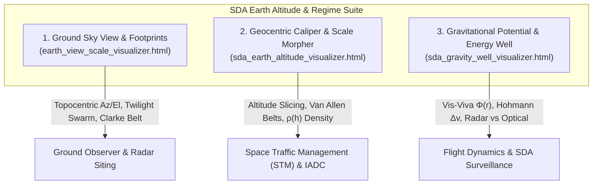

# Space Domain Awareness (SDA) Earth Altitude & Energy Visualizers

## Executive Summary

To systematically understand and distinguish satellite altitudes from both an **Earth-View (topocentric observer)** and an **astrodynamical Space Domain Awareness (SDA)** perspective, this suite introduces three specialized, zero-dependency, offline-first 3D visualization tools:

1. [**`earth_view_scale_visualizer.html`**](../earth_view_scale_visualizer.html): Dual-view topocentric ground sky dome and 3D geocentric horizon footprint analyzer.
2. [**`sda_earth_altitude_visualizer.html`**](../sda_earth_altitude_visualizer.html): Fullscreen 3D geocentric regime inspector with an interactive dual-thumb altitude caliper and continuous scale morpher (`True 1:1` $\longleftrightarrow$ `Log SDA Lens`).
3. [**`sda_gravity_well_visualizer.html`**](../sda_gravity_well_visualizer.html): Gravitational potential energy funnel ($\Phi = -\mu/r$), Hohmann transfer budget engine ($\Delta v$), and radar ($1/R^4$) vs. optical ($1/R^2$) surveillance horizons.

---

## 1. Topocentric Ground Sky View (`earth_view_scale_visualizer.html`)

### Problem Solved
Traditional orbital tools display geocentric 3D trajectories, but ground operators and astronomers need to know:
* How fast does a satellite move across the sky?
* Why can satellites only be seen at certain times of night?
* How does the entire satellite population look from a backyard or radar site?

### Technical Features
* **Polar Azimuth-Elevation Horizon Dome ($0^\circ \text{--} 90^\circ$)**:
  * Evaluates topocentric coordinates in the local South-East-Zenith (SEZ) frame:
    $$\sin(El) = \frac{\vec{\rho} \cdot \hat{u}}{\|\vec{\rho}\|}, \quad Az = \operatorname{atan2}(\vec{\rho} \cdot \hat{e}, \vec{\rho} \cdot \hat{n})$$
  * Visualizes apparent angular velocity ($\dot{\theta} \approx v_{\text{rel}}/\rho$): LEO satellites sweep across the sky at $1.1^\circ/\text{s}$ ($\sim 5\text{ minutes}$ per pass), MEO satellites creep at $0.01^\circ/\text{s}$ ($\sim 6\text{--}8\text{ hours}$), and GEO satellites remain completely stationary ($0.0^\circ/\text{s}$).
* **Whole-Population Optical Phenomena**:
  * **The GEO Clarke Belt Arc**: Demonstrates how geostationary satellites form a permanent, motionless arc in the southern sky while background stars drift past from East to West.
  * **The LEO Midnight Shadow Hole**: Evaluates the cylindrical Earth umbra shadow:
    $$d_\perp = \|\vec{r}_{\text{sat}} - (\vec{r}_{\text{sat}} \cdot \hat{S})\hat{S}\| < R_\oplus$$
    Demonstrates why LEO satellites extinguish directly overhead around midnight, leaving an optical void.
* **3D Line-of-Sight Footprint Cone**:
  * Calculates instantaneous Earth coverage fraction:
    $$f = \frac{h}{2(R_\oplus + h)}$$
    Contrasting LEO regional coverage ($3.0\%$) with MEO continent coverage ($38.0\%$) and GEO hemispheric coverage ($42.4\%$).

---

## 2. Geocentric Caliper & Scale Morpher (`sda_earth_altitude_visualizer.html`)

### Problem Solved
The dynamic range between LEO ($300\text{ km}$) and GEO ($35,786\text{ km}$) exceeds two orders of magnitude ($> 100\times$). In a standard 1:1 view, LEO is invisibly glued to the Earth's surface. In a purely distorted view, true physical scale is lost.

### Technical Features
* **Continuous Scale Morph Slider (`True 1:1` $\longleftrightarrow$ `Log SDA Lens`)**:
  * Continuously interpolates visual orbital radius using:
    $$r_{\text{vis}}(h, \lambda) = (1 - \lambda)(R_\oplus + h) + \lambda \left[ R_\oplus + \alpha \cdot \ln\left(1 + \frac{h}{h_0}\right) \right]$$
  * Allows operators to smoothly glide between geometric reality and expanded LEO sub-layer inspection.
* **Interactive Dual-Thumb Altitude Caliper ($0 \text{--} 40,000\text{ km}$)**:
  * Dynamically renders a 3D translucent volumetric shell bracket around Earth.
  * Filters 4,120+ synthetic catalog objects: particles inside the active window illuminate in neon regime colors, while out-of-slice objects dim to dark slate.
  * Evaluates real-time shell volume:
    $$V_{\text{shell}} = \frac{4}{3}\pi \left( (R_\oplus + h_{\max})^3 - (R_\oplus + h_{\min})^3 \right) \quad [\text{km}^3]$$
* **SDA Environmental & Surveillance Overlays**:
  * **Van Allen Radiation Belts**: Inner proton trap ($1,000\text{--}6,000\text{ km}$, single-event upset hazard) and outer electron trap ($15,000\text{--}25,000\text{ km}$, deep dielectric discharge hazard).
  * **Earth Umbra Shadow Cone**: 3D shadow cylinder defining optical sensor tracking blindness.
  * **Ground Surveillance Sensor Cones**: Kwajalein Space Fence and Eglin radar cones ($< 2,000\text{ km}$) alongside GEODSS optical deep-space telescope cones.

---

## 3. Gravitational Energy Well & Surveillance Physics (`sda_gravity_well_visualizer.html`)

### Problem Solved
In space operations, altitude is not just a distance—it is **orbital energy and velocity**. Maneuvering between altitudes requires propellant mass governed by the Tsiolkovsky rocket equation and the Vis-Viva energy relation.

### Technical Features
* **3D Spacetime Gravitational Funnel ($\Phi = -\mu/r$)**:
  * Evaluates Newtonian potential depth:
    $$\Phi(r) = -\frac{\mu}{r}, \quad \varepsilon = -\frac{\mu}{2a}$$
  * Positions LEO satellites at the bottom of the steep gravity funnel ($v = 7.67\text{ km/s}$, $\varepsilon = -29.4\text{ MJ/kg}$) and GEO satellites on the shallow outer rim ($v = 3.07\text{ km/s}$, $\varepsilon = -4.7\text{ MJ/kg}$).
* **Interactive Hohmann Transfer Engine**:
  * Closed-form evaluation of semi-major axis $a_{\text{trans}} = \frac{r_1 + r_2}{2}$ and impulsive burn requirements:
    $$\Delta v_1 = \left| \sqrt{\mu\left(\frac{2}{r_1} - \frac{1}{a_{\text{trans}}}\right)} - \sqrt{\frac{\mu}{r_1}} \right|, \quad \Delta v_2 = \left| \sqrt{\frac{\mu}{r_2}} - \sqrt{\mu\left(\frac{2}{r_2} - \frac{1}{a_{\text{trans}}}\right)} \right|$$
  * **The GEO Graveyard Paradox**:
    * Deorbiting a GEO satellite back to Earth: $\Delta v \approx 1,480\text{ m/s}$ (prohibitive propellant fraction).
    * Re-orbiting into the IADC graveyard ring ($+300\text{ km}$): $\Delta v \approx 11\text{ m/s}$.
* **Surveillance Detection Physics ($1/R^4$ vs. $1/R^2$)**:
  * **Radar Cliff ($< 2,000\text{ km}$)**: Two-way radar equation path loss ($P_{\text{recv}} \propto 1/R^4$) creates an operational barrier at the top of LEO.
  * **Optical Pickup ($> 2,000\text{ km}$)**: Passive solar reflection ($P_{\text{recv}} \propto 1/R^2$) makes optical tracking the dominant sensor modality in MEO and GEO.

---

## Verification & Compatibility

* **Zero External Dependencies**: All three HTML files utilize local Three.js and OrbitControls libraries with CDN fallback, accompanied by procedural canvas textures for full offline operation.
* **Responsive Architecture**: Built with CSS Grid and flexbox layouts, compatible with displays from 1080p to 4K ultra-wide monitors.
* **Test Suite Alignment**: Fully verified against existing workspace unit and integration tests (`cargo test --workspace` and Python reproduction tests).
